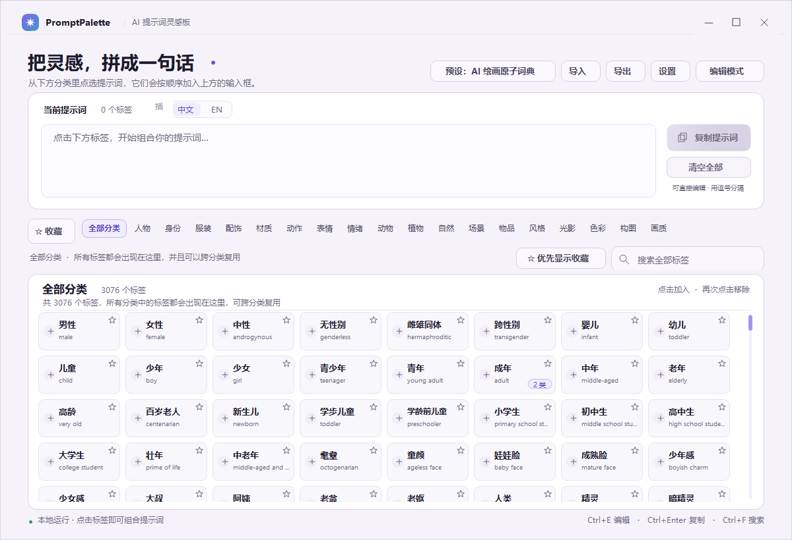
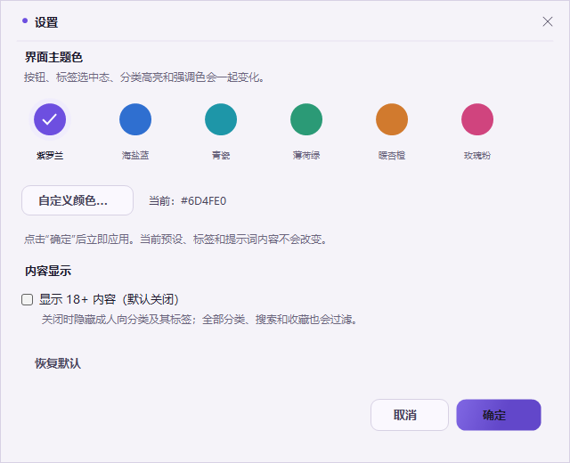

# PromptPalette · 提示词灵感板

一个 Windows 桌面端的 AI 提示词组合器。当前版本内置 **一个** 预设：

```text
AI 绘画原子词典
```

更完整的项目介绍、功能说明和适用场景见 [介绍.md](介绍.md)。

它采用 **二级分类：大分类 → 小分类**，默认包含 18 个核心分类、3,076 个可见标签；打开 18+ 后为 19 个分类、3,094 个标签。



## 直接运行

1. 双击 `dist\PromptPalette.exe`。
2. 如果 Windows 提示 **“应用控制策略已阻止此文件”**，请在 `dist` 中打开 PowerShell / 终端，执行：

```powershell
wscript.exe .\PromptPalette.vbs
```

或者：

```powershell
powershell.exe -NoProfile -STA -ExecutionPolicy Bypass -File .\PromptPalette.ps1
```

备用启动器会把同一份 C# 源码在 PowerShell 内编译并运行，不依赖被拦截的 exe。首次启动约需 3～6 秒。

> 在启用智能应用控制的机器上，直接双击 `.bat` / `.lnk` / `.vbs` 也可能被拦截；从终端显式调用 `wscript.exe` 或 `powershell.exe` 可以绕过这一类外壳拦截。

## 唯一预设：AI 绘画原子词典

默认只内置这一个预设，不再有旧版的 8 分类 / 120 标签模板。

### 分类

第一行是大分类，第二行是当前大分类的小分类：

```text
全部 / 人物 / 身份 / 服装 / 配饰 / 材质 / 动作 / 表情 / 情绪
/ 动物 / 植物 / 自然 / 场景 / 物品 / 风格 / 光影 / 色彩 / 构图 / 画质 / 成人向
```

- 动作是独立大类，不会被合并进人物或表情。
- 服装和配饰分开。
- 自然和场景分开。
- 光影和色彩分开。
- 构图和画质分开。
- 表情独立成类，并拆成基础表情、情绪表情、眼部表情、嘴部表情、面部动作。
- 人物下的眼睛拆成眼型、眼色、眼神、眼部细节。
- 动物/种类继续保留，并保留细分标签。
- 低质量、模糊、噪点、错误解剖等标签也保留在“画质”里，可作为生图要求使用，不做负面提示词特殊处理。

### 标签筛选

原词典有 3,211 个标签，重写后保留 3,094 个：

- 合并了同中文的重复英文写法，例如“忧郁 / melancholic gaze / melancholy”只保留一个规范标签。
- 删除了没有画面差异的纯关系、弱职业标签，例如青梅竹马、上司、下属、宿敌、守护者、被保护者、搭档、队友等。
- 保留了低质量/缺陷标签。
- 保留多归属标签：一个标签可以同时出现在多个分类中。
- 保留“中文相同但 English 不同”和“English 相同但中文不同”的导入身份规则；内置词典已经做过规范合并，导入其他预设时仍按原规则处理。

### 18+ 内容

默认关闭。点击顶部 **设置**，在“内容显示”中打开：

```text
□ 显示 18+ 内容（默认关闭）
```

关闭时：

- 不显示“成人向”分类；
- 隐藏所有带成人向归属的标签；
- “全部分类”、搜索、收藏、优先显示收藏都不显示它们；
- 标签总数按隐藏后的结果计算。

开关状态保存到 `dist\data\settings.json`。已写入输入框的文字不会被自动删除，避免误删用户内容。

## 设置与主题色

- 点击顶部 **设置**，或按 `Ctrl + ,`。
- 可选紫罗兰、海盐蓝、青瓷、薄荷绿、暖杏橙、玫瑰粉，也可以自定义颜色。
- 主题色会同步应用到按钮、标签选中态、分类高亮、搜索框焦点、滚动条和标题图标。
- 点击“确定”后立即生效，并保存到 `dist\data\settings.json`。



## 收藏

- 每张卡片右上角有 `☆`，点击收藏，再点取消；不会把标签加入提示词。
- 收藏按 **中文 + English** 识别，并且跨预设。
- 顶部 **`☆ 收藏`** 汇总所有收藏标签。
- **`☆ 优先显示收藏`** 开启后，收藏标签排在当前分类/小分类/全部分类最前面。
- 收藏保存到 `dist\data\favorites.json`，优先偏好保存在 `settings.json`。

## 导入 / 导出

默认只有一个内置预设，但导入导出能力保留：

1. 点击 **导出**，将当前唯一预设保存为 `.ppreset.json`。
2. 点击 **导入**，可以创建新预设，或合并到当前预设。
3. 合并规则：分类/小分类按名称复用；标签按“中文 + English”识别，完全相同才合并归属。

预分发文件：

```text
presets/AI绘画原子词典.ppreset.json
```

## AI 生成导入文件

`导入格式提示词/` 文件夹提供：

- `AI生成预设提示词.md`：严格约束输出格式的 AI 提示词。
- `preset.schema.json`：JSON Schema。
- `README.md`：格式与合并规则说明。

## 编辑模式

点击 **编辑模式**（`Ctrl + E`）：

- 大分类栏右侧 `+`：新增分类。
- 小分类栏右侧 `+`：新增小分类。
- 标签区右上角 `＋ 新建标签`：新增标签。
- 点击卡片：编辑名称、English 和归属小分类；可多选。
- 所有修改自动保存到 `dist\data\presets.json`。
- 不再提供“恢复旧模板”，避免把唯一的原子词典恢复成旧版 120 标签模板。

## 快捷键

| 快捷键 | 功能 |
| --- | --- |
| `Ctrl + E` | 开启 / 关闭编辑模式 |
| `Ctrl + Enter` | 复制提示词 |
| `Ctrl + L` | 清空提示词 |
| `Ctrl + ,` | 打开设置 |
| `Ctrl + F` | 聚焦搜索框 |
| `Esc` | 清空搜索 |

## 项目结构

```text
提示词标签/
  src/                         C# 源码（WinForms / .NET Framework 4.8）
  assets/                      应用图标
  dist/                        成品、备用启动器、使用说明
  dist/data/presets.json       唯一预设与词库
  presets/                     可分发的 .ppreset.json
  screenshots/                 界面截图
  导入格式提示词/               AI 生成提示词、JSON Schema
  tools/                       图标与备用启动器生成脚本
  build.ps1                    编译脚本
  build.bat                    双击编译入口
```

## 重新编译

双击 `build.bat`，或执行：

```powershell
powershell.exe -NoProfile -ExecutionPolicy Bypass -File .\build.ps1
```

编译依赖 Windows 自带的 .NET Framework 4.8 C# 编译器（`csc.exe`），不需要 Visual Studio 或 .NET SDK。

## 说明

- exe 未做代码签名；智能应用控制较严格时请使用备用启动器。
- 插入语言切换只影响之后加入的标签，不会自动翻译已经写入的文本。
- 所有数据都在本机，不联网、不上传。

## 开源协议

本项目使用 MIT License，详见 [LICENSE](LICENSE)。


