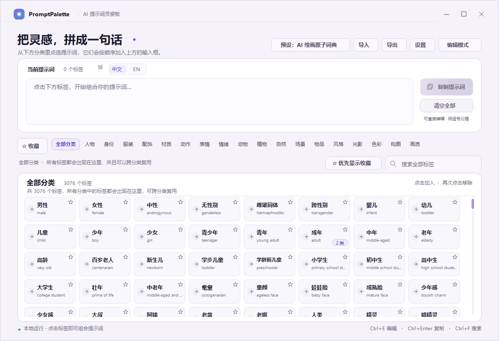
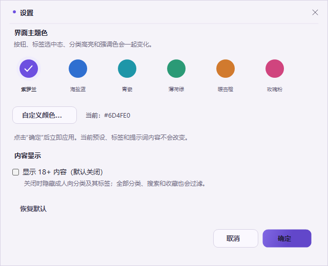

# PromptPalette · 提示词灵感板

> 一个把 AI 绘画提示词变成“可点击标签”的 Windows 桌面工具。

PromptPalette 是一个面向 AI 绘画、角色设定和提示词创作的本地桌面应用。它把大量提示词整理成分类标签，点击标签即可组合成完整提示词，也可以手动输入或从外部粘贴提示词，让已有标签自动高亮联动。

项目内置一个经过整理的预设 **「AI 绘画原子词典」**：18 个核心分类、3,076 个默认可见标签；开启 18+ 内容后为 19 个分类、3,094 个标签。



## 为什么做这个工具

写 AI 绘画提示词时，常见的问题是：

- 提示词太多，记不住、找不到；
- 每次都要手动输入相同的中文或 English 描述；
- 分类太粗，找“动作”“表情”“光影”时来回翻；
- 收藏和常用词散落在不同文档里；
- 从外部复制来一段提示词，应用无法识别里面已经有哪些标签。

PromptPalette 的解决方式是：把提示词做成 **可浏览、可搜索、可收藏、可编辑的标签库**，让组合提示词变成点选。

## 功能

### 唯一预设：AI 绘画原子词典

内置一个完整的绘画提示词预设，不附带旧版 8 分类 / 120 标签模板。

分类结构：

```text
人物 / 身份 / 服装 / 配饰 / 材质 / 动作 / 表情 / 情绪
/ 动物 / 植物 / 自然 / 场景 / 物品 / 风格 / 光影 / 色彩 / 构图 / 画质
/ 成人向（默认隐藏）
```

- 18 个核心分类 + 1 个成人向分类。
- 145 个小分类。
- 3,094 个标签；默认关闭 18+ 时可见 3,076 个。
- 动作是独立大类，包含基础姿态、头部、手部、腿部、移动、互动、战斗、舞蹈、穿衣、组合动作等。
- 表情独立成类，拆成基础表情、情绪表情、眼部表情、嘴部表情、面部动作。
- 所有标签至少有一个分类归属。
- 低质量、模糊、噪点、错误解剖等标签也保留在“画质”中，可作为生图要求使用。
- 一个标签可以同时归入多个分类，并完整汇总在“全部分类”视图。

### 二级分类导航

第一行是大分类，第二行是当前大分类的小分类。分类栏使用紧凑宽度，尽量在 1200px 宽度内显示全部大分类；小分类较多时支持横向滚动。

### 标签组合

- 点击标签加入上方输入框。
- 再次点击已选标签移除。
- 中文 / EN 切换插入语言。
- 一键复制完整提示词。
- 一键清空。
- 输入框可直接手动编辑，提示词按逗号整理。

### 手动输入 / 外部粘贴联动

输入或粘贴一段提示词后，应用会自动识别已有标签：

- 支持中文标签名；
- 支持 English 标签名；
- 支持整段文字中的标签短语；
- 匹配的卡片自动高亮，并计入“当前提示词”标签数。

### 收藏

- 卡片右上角 `☆` 收藏，再点取消。
- 收藏按“中文 + English”识别，跨预设保留。
- 顶部“收藏”汇总所有收藏标签。
- “优先显示收藏”可让收藏标签排在当前分类或全部分类最前面。
- 收藏不会改变提示词内容。

### 编辑模式

- 新增大分类、小分类、标签。
- 编辑标签中文名、English 和归属小分类。
- 支持一个标签选择多个小分类。
- 修改自动保存到本地 `presets.json`。

### 主题色

- 紫罗兰、海盐蓝、青瓷、薄荷绿、暖杏橙、玫瑰粉。
- 支持自定义颜色。
- 同步改变按钮、选中态、分类高亮、搜索焦点、滚动条和标题图标。
- 设置立即生效并保存。

### 18+ 内容开关

设置中提供“显示 18+ 内容”，默认关闭。

关闭时：

- 隐藏成人向分类；
- 隐藏所有带成人向归属的标签；
- 全部分类、搜索、收藏和标签数量同步过滤；
- 不删除数据，打开开关即可恢复。

### 导入 / 导出

- 可将当前预设导出为 `.ppreset.json`。
- 可导入其他预设，创建新预设或合并到当前预设。
- 合并时分类按名称复用，标签按“中文 + English”识别。
- 中文相同但 English 不同、English 相同但中文不同，仍视为不同标签。

项目提供了可分发的唯一预设：

```text
presets/AI绘画原子词典.ppreset.json
```

## AI 生成导入格式

`导入格式提示词/` 文件夹提供：

- 严格约束 AI 输出格式的生成提示词；
- JSON Schema；
- 导入格式与合并规则说明。

AI 只输出一个合法 JSON 对象，保存后即可通过应用导入。

## 界面预览

| 主界面 | 设置 |
| --- | --- |
|  |  |

## 启动

直接运行：

```text
dist/PromptPalette.exe
```

如果 Windows 智能应用控制拦截未签名 exe，可在 `dist` 中运行：

```powershell
wscript.exe .\PromptPalette.vbs
```

或：

```powershell
powershell.exe -NoProfile -STA -ExecutionPolicy Bypass -File .\PromptPalette.ps1
```

备用启动器会在内存中编译源码运行，不依赖 exe 文件。

## 技术栈

- Windows Forms
- .NET Framework 4.8
- C# 5
- 单文件 exe
- 自绘浅色 UI
- 虚拟化标签网格
- DataContract JSON 本地存储
- PowerShell 内存编译备用启动器

## 数据与隐私

- 不联网、不上传。
- 预设、收藏、设置均保存在本地 `dist/data/`。
- 主题色和 18+ 偏好保存在 `settings.json`。
- 收藏保存在 `favorites.json`。
- 直接复制整个项目文件夹即可迁移数据。

## 项目结构

```text
提示词标签/
  src/                         C# 源码
  assets/                      应用图标
  dist/                        成品与备用启动器
  dist/data/presets.json       唯一预设与词库
  presets/                     可分发的 .ppreset.json
  screenshots/                 界面截图
  导入格式提示词/               AI 提示词与 JSON Schema
  tools/                       构建辅助脚本
  build.ps1 / build.bat        编译入口
  README.md                    项目说明
  LICENSE                      MIT
```

## 适合谁

- 经常写 AI 绘画提示词的人；
- 需要管理大量角色、服装、动作、场景、风格标签的人；
- 想用点击方式快速组合提示词的人；
- 想把自己整理的词库分享给别人的创作者；
- 想学习 WinForms 自绘界面、虚拟滚动和本地 JSON 数据设计的开发者。

## 开源协议

MIT License，详见 [LICENSE](LICENSE)。

## 最后

PromptPalette 的目标不是替代创作，而是把重复的提示词查找和输入工作收起来，让你把注意力放回画面本身。
